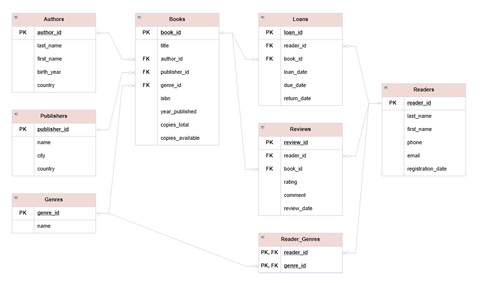

# Книжковий матчмейкер

Курсова робота з дисципліни «Технології проектування та адміністрування баз даних та сховищ даних».
Виконала Шевченко Анна, група ТЦР-31.

Інформаційна система бібліотеки: облік книг, читачів і видач, а також підбір книг для кожного читача
за його вподобаннями.

## Можливості

- каталог книг з пошуком за назвою або автором і фільтрами за жанром та наявністю;
- облік читачів та їхніх улюблених жанрів;
- видача й повернення книг, список боржників;
- відгуки та оцінки читачів;
- статистика: найпопулярніші книги та жанри;
- підбір книг для читача з відсотком збігу: улюблений жанр (50), улюблений автор (30),
  середня оцінка книги (до 20);
- довідники авторів, видавництв і жанрів;
- перевірка даних у формах і в базі даних (обмеження та тригери).

## Технології

C#, .NET 10, ASP.NET Core Razor Pages, Dapper, Microsoft SQL Server Express, Bootstrap 5.

## Структура репозиторію

| Файл або папка | Що містить |
| --- | --- |
| `create_database.sql` | створення бази даних: таблиці, обмеження, індекси, тригери, процедура підбору книг |
| `insert_data.sql` | тестові дані |
| `queries.sql` | сім інформаційно-пошукових запитів |
| `Даталогічна_модель_Книжковий_матчмейкер.png`, `.drawio` | даталогічна модель бази даних |
| `LibraryMatchmaker/` | вебзастосунок (рішення для Rider або Visual Studio) |
| `docs/` | скріншоти для цього опису |

## Як запустити

1. Встановити Microsoft SQL Server Express, SQL Server Management Studio і .NET 10 SDK.
2. У SQL Server Management Studio виконати `create_database.sql`, потім `insert_data.sql`.
3. Якщо сервер називається не `.\SQLEXPRESS`, змінити рядок підключення у файлі
   `LibraryMatchmaker/LibraryMatchmaker/appsettings.json`.
4. Відкрити `LibraryMatchmaker/LibraryMatchmaker.sln` у Rider або Visual Studio і запустити застосунок
   (або виконати `dotnet run` у папці `LibraryMatchmaker/LibraryMatchmaker`).
   Застосунок відкриється за адресою http://localhost:5150.

## Даталогічна модель

## Скріншоти

